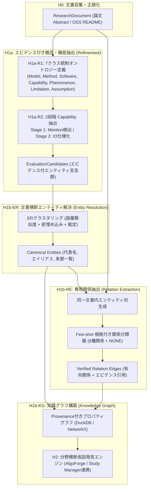
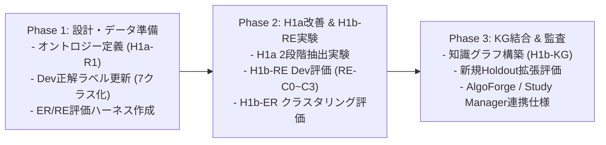

# HDE H1b & H1a Refinement — 研究計画・設計仕様書 v0.1

**Status:** Proposed — Scientific Review Pending  
**Date:** 2026-11-16  
**Target:** Hypothesis Discovery Engine (HDE)  
- **H1a Refinement:** H1a-R1（オントロジー・境界再定義）, H1a-R2（Capability Recall改善）  
- **H1b Core:** H1b-ER（Entity Resolution独立評価）, H1b-RE（専用Relation Extraction）, H1b-KG（Provenance付きKnowledge Graph構築）  
**Supersedes:** H1a Phase 3 Holdout Pilot完了に伴う次期フェーズ移行  

---

## 0. 背景と基本方針

HDE H1aのHoldout Pilot評価（12文書 × 3試行 = 36回呼出）により、以下の重要な科学的知見が実測で確立されました。

1. **抽出と関係の分離の必要性:**  
   単一プロンプト内でゼロショットによりエンティティと局所関係（LocalRelation）を同時生成させる方式は、HoldoutにおいてリレーションRecall 0.0%（36試行中36試行で空配列出力）となり、完全に出力が抑制されることが判明した。
2. **オントロジー境界の曖昧性:**  
   学術論文における「Model（数理モデル）」と「Method（推定・計算法）」の境界、およびOSSにおける「Software/Tool（実行基盤）」と「Model」の境界が未分化であったため、正解概念を抽出していながらクラス不一致によるペナルティが発生した。
3. **Capability抽出の細粒度化とRecall不足:**  
   CapabilityはHoldout全文書で抽出されたものの、自然文からの動詞句切り出し粒度が安定せず、Recallが0.333に留まった。

これらを踏まえ、本計画では**「エンティティ抽出（H1a）」「エンティティ解決（H1b-ER）」「関係抽出（H1b-RE）」「知識グラフ構築（H1b-KG）」の4責務を完全に分離**し、それぞれの入力、出力、対照群、評価指標を独立して定義する。

> [!IMPORTANT]
> **データセット規律（Holdoutの再利用禁止）:**  
> H1b-REおよびH1a改善のプロンプト設計・ハイパーパラメータ調整・アルゴリズム設計には、**既存のDevelopment Set（10文書）のみを使用**する。Holdout Pilot（12文書）はテスト済みデータとして扱い、改善後の評価には新しい未公開評価セット（Holdout Expansion 10文書等）を準備する。

---

## 1. ワークストリーム構成と全体アーキテクチャ

---

## 2. H1a-R1: Model / Method / Software の分類境界再定義

### 2.1 課題と目的
Holdout実験で生じたModel（確率過程モデル）とMethod（パラメータ推定手順）の混同、およびOSS実装（Backtrader、Matching Engine等）をModelに割り当てたことによるRecall低下を解消するため、オントロジーを従来の6クラスから**7クラス**へと改訂する。

### 2.2 7クラス統制オントロジー定義

| エンティティ型 | 定義・操作的基準 | 原典の典型表現 | 代表例 |
| :--- | :--- | :--- | :--- |
| **Model** | 現象を記述・説明・シミュレートするための**数理的・統計的・理論的構造・定式化**。アルゴリズムそのものではなく構造を指す。 | "... model", "... process", "... dynamics", "... network structure" | Markov-Switching GARCH, Ornstein-Uhlenbeck, Spin Glass, Stochastic SIR |
| **Method** | モデルのパラメータ推定・学習・最適化・検定を行うための**アルゴリズム・計算手順・推論手続**。 | "... algorithm", "... estimation method", "... inference technique", "... approach" | Maximum Likelihood Estimation, Replica Symmetry Breaking, Invariant Causal Discovery |
| **Software** | 再利用可能な**コードベース・実行フレームワーク・シミュレータ環境・実行基盤ツール**。 | "... framework", "... engine", "... library", "... Python package", "... platform" | Backtrader, Matching Engine, FinRL Gym Environment, QuantLib |
| **Capability** | モデル・手法・ソフトウェアが入力データに対して実行可能な**操作的・機能的タスク**。$C = (V, O, C_{cond}, T_{res})$ | "estimate ...", "predict ...", "simulate ...", "generate ...", "optimize ..." | Infer Transition Probabilities, Simulate Order Books, Match Limit Orders |
| **Phenomenon** | 説明・予測・再現の対象となる**市場・自然・システムにおける観測可能な実世界事象・効果**。 | "... regime", "... volatility", "... contagion", "... anomaly", "... arbitrage" | Tail Risk Contagion, Volatility Clustering, Momentum Effect |
| **Limitation** | 手法・モデルの**適用制約・計算上の限界・不成立条件**。 | "... under high latency", "... fails when ...", "... computational bottleneck" | Asymmetric Network Latency Bottleneck, High Dimensionality Breakdown |
| **Assumption** | 理論・モデルが成立するために要求される**事前前提・分布仮定**。 | "assuming ...", "under the condition that ...", "independent and identically distributed" | Gaussian Noise, Stationarity, Frictionless Market |

### 2.3 入力・出力仕様
- **入力:** H0正規化テキスト（`abstract_text` または `readme_text`）およびタイトル。
- **出力:** 7クラスのいずれかに分類され、原典の厳密な引用（`verbatim_quote`）とオフセットを持つエンティティ言及群。
- **追加リレーション型:** `Software -> IMPLEMENTS -> Model/Method`（ソフトウェアがモデルや手法を実装している関係）。

---

## 3. H1a-R2: Capability Recall改善

### 3.1 課題と目的
HoldoutにおけるCapability Recall（0.333）およびMicro F1（0.314）の低迷を打破するため、抽出処理を「言及検出」と「詳細仕様化」の**2段階（Two-Stage）パイプライン**に再設計する。

### 3.2 2段階抽出パイプライン設計
- **Stage 1 (Mention Extraction & Classification):**  
  原文から7クラスのエンティティ言及とエビデンス引用のみを高感度（High Recall）に抽出する。この段階では入出力（`inputs`, `outputs`）の型アノテーションを要求せず、LLMのトークン生成負荷を低減する。
- **Stage 2 (Capability Deep Typing & IO Normalization):**  
  Stage 1で検出されたCapability言及（およびその周辺文脈）に対してのみ、入出力仕様（L1データ型、時間解像度、次元、未指定フラグ）を抽出・検証する。
- **Few-shot例示の導入:**  
  テストデータから完全に独立した汎用的な2例（論文1例、OSS 1例）のFew-shot例示をプロンプト内に導入し、動詞句の過度な省略や過剰な細粒度化を抑止する。

### 3.3 評価指標と目標値（Development Set 10文書にて検証）
- **Capability Recall:** 0.333 $\to$ **$\ge 0.650$**
- **Quote Integrity (引用妥当性):** **$\ge 98.0\%$** を維持
- **入出力型検証合格率:** **$\ge 90.0\%$**

---

## 4. H1b-ER: 文書横断エンティティ解決 (Entity Resolution)

### 4.1 責務と役割
異なる文書から抽出されたエンティティ言及群（例: 文書Aの `Markov-switching GARCH` と 文書Bの `MS-GARCH`）が、同一の概念を指しているかを判定し、標準的なカノニカルエンティティ（代表概念）に統合する。

### 4.2 入力・出力仕様
- **入力:**  
  文書横断で収集されたエンティティ言及集合 $M = \{m_1, m_2, \dots, m_N\}$。  
  各言及 $m_i$:
  - `mention_id`: 一意の言及識別子
  - `source_id`: 原典文書ID（arXiv IDまたはGitHub repo ID）
  - `entity_type`: 7クラスのいずれか
  - `mention_text`: 抽出された名称または記述
  - `evidence_quote`: 原典内の引用文字列
  - `context_text`: 引用周辺文脈（前後200文字）
- **出力:**  
  解決済みカノニカルエンティティ集合 $E = \{e_1, e_2, \dots, e_K\}$ ($K \le N$)。  
  各カノニカルエンティティ $e_k$:
  - `canonical_id`: 一意のUUID
  - `canonical_name`: 代表名称
  - `entity_type`: 共通のエンティティ型
  - `aliases`: 別名・同義語リスト
  - `member_mentions`: 統合された言及IDリスト
  - `provenance_sources`: 出現元文書一覧

### 4.3 比較対照群（ER-C0 〜 ER-C3）

| 条件ID | 手法名称 | アルゴリズム詳細 |
| :--- | :--- | :--- |
| **ER-C0** | 完全字面一致 (Lexical Baseline) | 小文字化・空白正規化後の文字列が完全一致する場合のみ同一エンティティとして統合。 |
| **ER-C1** | 規則・編集距離 (Edit Distance + Acronym) | レーベンシュタイン類似度 $\ge 0.85$ または 頭字語規則（例: `MS-GARCH` $\leftrightarrow$ `Markov-Switching GARCH`）に合致する同一型言及を統合。 |
| **ER-C2** | 密埋め込みクラスタリング (Dense Embedding) | 科学技術ドメイン埋め込みモデル（例: `text-embedding-3-small` または `SciBERT`）によるコサイン類似度を用いた階層型凝集クラスタリング（閾値 $\tau$）。 |
| **ER-C3** | 埋め込み候補絞込 + LLM意味的裁定 (Hybrid Proposed) | ER-C2で類似度が高かった候補対（境界領域）に対し、原文コンテキストを提示してLLMが同一概念かをYes/No判定し、推論理由を記録する。 |

### 4.4 評価指標と基準データ
- **評価用正解クラスタ:** Development Set（10文書）および追加文書群における複数文書間の同一概念ペア（True Equivalence）と非同一ペア（False Equivalence）の人手検証済みベンチマーク。
- **評価指標:**
  - **Pairwise Precision, Pairwise Recall, Pairwise F1:** 全ペアに対する同一判定の正誤。
  - **Cluster Purity（純度） & Completeness（網羅度）:** 正解クラスタとの合致率。
  - **Over-merging Rate（過統合率 / 異なる概念の誤統合）:** ゼロ許容を目指す重要指標。

---

## 5. H1b-RE: 専用関係抽出 (Relation Extraction)

### 5.1 責務と役割
同一文書（または同一コンテキスト）に現れるエンティティ対に対し、どのような有向関係が存在するかを判定し、原典のエビデンスを付与する。H1aのゼロショット同時抽出の失敗を克服するため、エンティティ対を入力とする専用分類ステージとして構成する。

### 5.2 入力・出力仕様
- **入力:**  
  1. 対象文書のテキスト（Abstract / README）
  2. 同一文書内に存在するエンティティ対 $(e_{src}, e_{dst})$ とそれぞれの出現位置・引用文
- **出力:**  
  関係ラベル $r \in \mathcal{R} \cup \{\text{NONE}\}$ およびそれを支持する文単位のエビデンス引用。  
  $\mathcal{R} = \{\text{EXPLAINS}, \text{APPLIES\_TO}, \text{PROVIDED\_BY}, \text{REQUIRES}, \text{CONSTRAINED\_BY}, \text{IMPLEMENTS}\}$

### 5.3 比較対照群（RE-C0 〜 RE-C3）

| 条件ID | 手法名称 | アルゴリズム詳細 |
| :--- | :--- | :--- |
| **RE-C0** | 共起型規則ベース (Co-occurrence Baseline) | 同一文内に共起したエンティティ対に対し、型制約（例: `Model` と `Phenomenon` なら `EXPLAINS`）に基づいて一律に関係を付与。 |
| **RE-C1** | ゼロショット文脈分類 (Zero-shot Binary RE) | 原文文脈と対象ペア $(e_{src}, e_{dst})$ をLLMに提示し、関係型を分類（該当なしは `NONE`）。 |
| **RE-C2** | Few-shot 思考連鎖分類 (Few-shot CoT RE) | 各関係型の典型的な文脈例（ポジティブ例およびネガティブ例）をFew-shot提示し、関係の成立理由を説明させた上で分類。 |
| **RE-C3** | Few-shot + エビデンス検証フィルタ (Grounded RE Proposed) | RE-C2で関係ありと判定された出力に対し、指定されたエビデンス文が実際に原文に存在し、かつ双方のエンティティを含んでいるかを決定論的に検証。 |

### 5.4 評価指標と基準データ
- **評価用データ:** Development Set 10文書における全正解リレーション（11件）および共起するが関係のないネガティブ対（True Negatives）。
- **評価指標:**
  - **Non-NONE Relation Precision, Recall, F1:** 偽陽性（過剰関係付与）と偽陰性の厳密測定。
  - **Directional Accuracy（有向エッジの向きの正確度）:** $e_{src} \to e_{dst}$ の正しさ。
  - **Evidence Integrity:** 関係エビデンスが原典文と完全一致する率（目標100%）。

---

## 6. H1b-KG: Provenance付き知識グラフ構築

### 6.1 グラフデータモデル
- **Node (Entity):**
  - `entity_id`: UUID
  - `canonical_name`: 代表名
  - `entity_type`: `model`, `method`, `software`, `capability`, `phenomenon`, `limitation`, `assumption`
  - `aliases`: JSON配列
  - `provenance`: `[{"source_id": "...", "version_hash": "...", "quote": "...", "offsets": [s, e]}]`
- **Edge (Relation):**
  - `edge_id`: `{src_id}->{type}->{dst_id}`
  - `src_entity_id`: 始点ノードUUID
  - `dst_entity_id`: 終点ノードUUID
  - `relation_type`: `EXPLAINS`, `APPLIES_TO`, `PROVIDED_BY`, `REQUIRES`, `CONSTRAINED_BY`, `IMPLEMENTS`
  - `provenance_evidence`: 文書ID、引用文、文字オフセット
  - `extraction_run_id`: 抽出試行識別子

### 6.2 ストレージと整合性制約
- **ストレージ基盤:** SQLite / DuckDB（リレーショナル管理）＋ NetworkX（グラフ解析・探索）。
- **整合性ルール:**
  1. 孤立エッジの禁止（存在しないノードへの外部キー参照は即時リジェクト）。
  2. 自己ループ（$u \to u$）の禁止。
  3. 全ノード・全エッジが最低1件のH0暗号学的ハッシュ（`version_hash`）に遡及可能であること（Provenance保証）。

---

## 7. 実行ロードマップと予算計画

### 7.1 フェーズ別実施順序

### 7.2 予算枠とAPI消費見込み
- **現時点の累計消費:** \$0.076675 USD / 上限 \$10.00 USD（**残高: \$9.923325 USD**）
- **Phase 1〜2 開発・検証呼出見込み:**
  - H1a-R2 実験（10文書 × 2試行 = 20呼出）: 約 \$0.015 USD
  - H1b-RE 実験（約30ペア × 4条件 = 120呼出）: 約 \$0.040 USD
  - H1b-ER 裁定実験（約20境界ペア = 20呼出）: 約 \$0.010 USD
  - **合計予想費用:** 約 **\$0.065 USD**（残高 \$9.92 の約0.6%）
- 二段階予算予約および `data/budget_ledger.jsonl` への即時記録を全API呼出で徹底継続。
