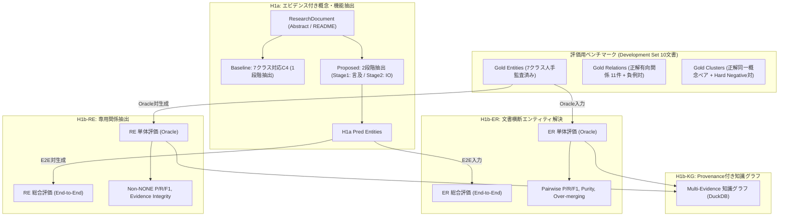
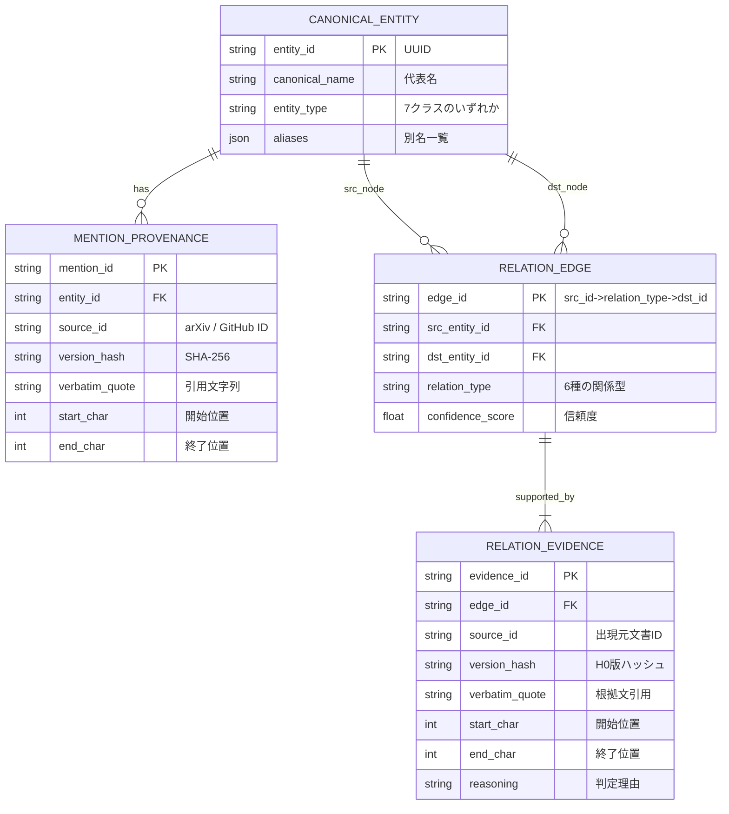

# HDE H1b & H1a Refinement — 研究計画・設計仕様書 v0.2

**Status:** Approved by Reviewer (`[PLAN APPROVED]`)  
**Date:** 2026-11-16  
**Target:** Hypothesis Discovery Engine (HDE)  
- **H1a Refinement:** H1a-R1（7クラスオントロジー・境界再定義）, H1a-R2（2段階 Capability 抽出）  
- **H1b Core:** H1b-ER（Oracle & E2E Entity Resolution）, H1b-RE（Oracle & E2E Relation Extraction）, H1b-KG（Multi-Evidence Provenance KG）  
**Supersedes:** H1b & H1a Refinement Plan v0.1  

---

## 0. v0.2 改訂概要（レビュー指摘事項の完全反映）

| 項目 | 指摘内容 | v0.2 における反映・設計 |
| :--- | :--- | :--- |
| **D1: 実験の完全分離 (Oracle vs E2E)** | H1aのRecall不足とH1bのER/RE性能を混同しない | ERおよびREの評価に**Goldエンティティを入力する「Oracle条件」**と、**H1a実際の出力を入力する「End-to-End条件」**を並行評価し、上流誤差の伝播を厳密に切り分ける。 |
| **D2: H1a-R2 比較の公平性** | オントロジー変更効果と方式変更効果の切り分け | 7クラス化した同一のDevelopment Set・同一評価器上で、**旧C4ベースライン**と**新2段階Proposed**を直接比較。Precision, Recall, F1, Quote Integrity, IO合格率を併記。 |
| **D3: ER 推移律とHard Negative** | $A=B, B=C, A \neq C$ による過統合防止 | 単純な連結成分（Connected Components）を禁止し、**完全連結（Complete Linkage）または相関クラスタリング（Correlation Clustering）**によるクラスタ形成規則を採用。似ているが異なるHard Negativeペアをベンチマークに必須化。 |
| **D4: RE 照応・エビデンス制約** | 引用文が双方の名前を含む制約が厳しすぎる | RE-C3において、同一文内共起だけでなく、指示代名詞・略称を含む文脈文を許容する**照応対応エビデンス検証**を導入し、Evidence IntegrityとRecallのトレードオフを実測。 |
| **D5: KG 多重エビデンス構造** | 同一エッジが複数文書で支持されるケース | `edges`（関係実体：`src_id -> type -> dst_id`）と `relation_evidences`（文書別引用・オフセット・来歴）を別テーブルに分離する正規化スキーマを採用。 |
| **D6: 呼出数と予算の最適化** | RE-C0（規則）とRE-C3（RE-C2再利用）のAPI節約 | RE-C0（0呼出）、RE-C3（0追加呼出）とし、API呼出対象をRE-C1およびRE-C2のみに絞り込み、予算消費を極小化。 |

---

## 1. ワークストリームと実験条件（Oracle vs End-to-End）

---

## 2. 7クラスオントロジーとスキーマ定義 (H1a-R1 & H1b-KG)

### 2.1 7クラスの定義と境界基準

1. **`model`**: 現象の数理的・統計的・理論的構造・定式化（例: Markov-Switching GARCH, Ornstein-Uhlenbeck, Stochastic SIR）。
2. **`method`**: 推定・学習・最適化・検定のアルゴリズム手順（例: MLE, Replica Symmetry Breaking, Invariant Causal Discovery）。
3. **`software`**: 再利用可能なコードベース・実行フレームワーク・シミュレータ環境（例: Backtrader, Matching Engine, FinRL Gym）。
4. **`capability`**: 操作的機能タスク $C = (V, O, C_{cond}, T_{res})$（例: Infer Transition Probabilities, Simulate Order Books）。
5. **`phenomenon`**: 説明・予測・再現の対象となる観測可能事象（例: Tail Risk Contagion, Volatility Regimes）。
6. **`limitation`**: 手法・モデルの適用制約・計算上の限界（例: Asymmetric Latency Bottleneck）。
7. **`assumption`**: 理論・モデルが成立するために要求される事前前提（例: Stationarity, Frictionless Market）。

### 2.2 関係型（6種類）
- `EXPLAINS`: Model/Method $\to$ Phenomenon
- `APPLIES_TO`: Method $\to$ Model
- `PROVIDED_BY`: Capability $\to$ Model/Method/Software
- `IMPLEMENTS`: Software $\to$ Model/Method （新規追加）
- `REQUIRES`: Capability/Model $\to$ Assumption
- `CONSTRAINED_BY`: Capability/Model/Method/Software $\to$ Limitation

### 2.3 知識グラフの多重エビデンス・正規化データモデル (H1b-KG)

---

## 3. H1a-R2: 2段階抽出パイプラインと公平な比較設計

### 3.1 比較条件
- **Baseline (C4-7Class):**  
  7クラススキーマを直接1段階で生成させる現行C4プロンプト（Zero-shot）。
- **Proposed (Two-Stage-C5):**  
  - **Stage 1 (Mention Extraction):** テキストから7クラスのエンティティ言及名とエビデンス引用のみを高感度抽出（Few-shot 2例付）。
  - **Stage 2 (Capability IO Typing):** Stage 1で検出されたCapabilityに対し、入出力（L1データ型、時間解像度、未指定フラグ）を集中的に判定。

### 3.2 評価指標（Development Set 10文書、全3反復）
- Capability Precision, Recall, F1（意味的同値性判定）
- Overall Entity Precision, Recall, Micro F1
- Resolved Quote Integrity Rate（$\ge 98\%$ を維持）
- IO Schema Compliance Rate（$\ge 90\%$ を維持）

---

## 4. H1b-ER: エンティティ解決の独立評価 (Oracle & E2E)

### 4.1 入力と対照群
- **Oracle評価:** Development Setの全Goldエンティティ言及を入力とし、クラスタリング性能の上限を測定。
- **End-to-End評価:** H1a抽出器の実際の出力を入力とし、上流の誤抽出・漏れが存在する実環境での性能を測定。

| 条件ID | 手法 | クラスタ形成規則（推移律対策） |
| :--- | :--- | :--- |
| **ER-C0** | 完全字面一致 | 小文字・空白正規化後の文字列が完全一致する連結成分。 |
| **ER-C1** | 規則・編集距離 | レーベンシュタイン類似度 $\ge 0.85$ または頭字語合致。完全連結クラスタリング（全ペアが条件を満たす場合のみ統合）。 |
| **ER-C2** | 密埋め込み凝集 | `text-embedding-3-small` のコサイン類似度を用いた完全連結（Complete Linkage）階層型クラスタリング（閾値 $\tau=0.82$）。 |
| **ER-C3** | 埋め込み候補絞込 + LLM裁定 | ER-C2で類似度 $\ge 0.70$ の候補ペアに対し、LLMが文脈付きで同一概念かをYes/No判定。クラスタ統合時は、**全ペアの合意または最小カット（Minimum Cut）**により推移矛盾を解消。 |

### 4.2 評価データと指標
- **ベンチマークデータ:**  
  Development Set 10文書および追加検証文書から作成された、同一概念ペア（True Equivalence）と、似ているが明確に異なる**Hard Negativeペア**（例: `GARCH` vs `MS-GARCH`, `Backtrader` vs `PyAlgoTrade`, `Order Matching` vs `Order Execution`）。
- **評価指標:**  
  Pairwise Precision, Pairwise Recall, Pairwise F1, Cluster Purity, Cluster Completeness, Over-merging Rate（過統合率）。

---

## 5. H1b-RE: 専用関係抽出の独立評価 (Oracle & E2E)

### 5.1 入力と対照群
- **Oracle評価:** 同一文書内に存在するGoldエンティティ対 $(e_{src}, e_{dst})$ を入力とし、関係分類器自体の性能を評価。
- **End-to-End評価:** H1aが実際に抽出したエンティティ対を入力とし、パイプライン全体の関係獲得性能を評価。

| 条件ID | 手法 | API呼出 | 処理概要 |
| :--- | :--- | :---: | :--- |
| **RE-C0** | 共起型規則ベース | **0回** | 同一文内に共起したエンティティ対の型シグネチャに基づき、決定論的ルールで関係付与。 |
| **RE-C1** | ゼロショット文脈分類 | 必要 | 原文文脈と対象ペアをLLMに提示し、関係型（またはNONE）を判定。 |
| **RE-C2** | Few-shot 思考連鎖分類 | 必要 | 典型例をFew-shot提示し、短い判定理由＋関係型＋根拠引用を構造化出力。 |
| **RE-C3** | RE-C2再利用 + エビデンス検証 | **0追加** | RE-C2の出力を決定論的エビデンス検証器に通し、引用文が原典に実在し、代名詞・略称を含む文脈合致性を検証。 |

### 5.2 評価データと指標
- **ベンチマークデータ:**  
  Development Set 10文書の全正解有向関係（11件）および共起するが無関係なネガティブ対（True Negatives）。
- **評価指標:**  
  Non-NONE Relation Precision, Recall, F1、Directional Accuracy、Evidence Integrity vs Recall Trade-off。

---

## 6. 実行ステップと予算管理

### 6.1 フェーズ1 実行計画
1. **Step 1.1: 7クラスPydanticスキーマ更新** (`models.py`)
2. **Step 1.2: Development Set ベンチマーク更新** (7クラス化、ER正例/Hard Negative対、RE正例/負例対)
3. **Step 1.3: 単体テスト実行** (53テスト以上の全数合格検証)
4. **Step 1.4: H1a-R2, H1b-ER, H1b-RE 実験ランナー実装**

### 6.2 予算枠
- 現残高: **\$9.923325 USD**
- 実験消費見込み: RE-C1/C2 (約60回) + H1a-R2 (20回) + ER-C3 (20回) $\approx$ **\$0.050 USD**
- 二段階予約方式による上限遵守を継続。
