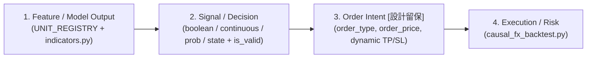

# AlgoForge Phase 2A 統合 Unit / Signal アーキテクチャ設計書（v0.1）

**日付**: 2026-11-22  
**対象リポジトリ**: `algoforge`（本体）および `algoforge_pipeline`（`research_pipeline`）  
**ステータス**: Phase 2A 監査・設計成果物（既存コード・Registry・履歴は一切無変更）  

---

## 1. 監査したコードと根拠箇所

| リポジトリ / ファイル | 監査した主要シンボル・構造 | 既存実装・不足機能・新規設計の区別 |
|---|---|---|
| `algoforge/backend/strategy/engine/indicators.py` | `apply_indicators(df, specs)` | **既存実装**: 20種以上の指標・外部イベント（`event`, `supply_event`, `carry`）を DataFrame 列へ追加。 **不足**: 動的登録レジストリ、Unit バージョン管理、`is_valid` マスク分離。 |
| `algoforge/backend/strategy/engine/conditions.py` | `evaluate_conditions(row, block, ctx)` | **既存実装**: 1階層 `and`/`or`、`streak`、`regime`、`rolling`。 **不足**: 多段入れ子論理式、欠損時安全マスク。 |
| `algoforge/backend/strategy/engine/execution.py` / `backtest.py` | `RiskParams`, `OpenPosition`, `_normalise` | **既存実装**: `%` コスト、TP優先、Trailing Stop。 **差異**: `causal_fx_backtest.py`（SL優先・Bid-OHLC固定pip）と非互換。 |
| `algoforge_pipeline/src/.../discovery/econometric_modules.py` | `HawkesDiscreteHazardModel`, `HamiltonLogRVRegimeModel`, `LocalJumpDetector` | **既存実装**: 統計・計量経済モジュール。 **不足**: Strategy JSON の `indicators` から直接呼び出す統一 Unit インターフェース。 |
| `algoforge_pipeline/src/.../integration/algoforge_adapter.py` | `validate_algoforge_strategy`, `evaluate_algoforge_conditions_vectorized` | **既存実装（Phase 1B-1）**: Entry専用検証、ベクトル化比較・論理、Capability Request 生成。 |
| `algoforge_pipeline/src/.../backtest/strategy_registry.py` | `compute_algoforge_strategy_hash`, `compute_algoforge_evaluation_hash` | **既存実装（Phase 1B-1）**: `algoforge_v1` 名前空間分離、`unit_versions` 枠組み。 |

---

## 2. 現行アーキテクチャの課題と Phase 1B 対応範囲の確定

- **Phase 1B 対応範囲（確定）**: `ema`, `sma`, `rsi`, `atr`, `bb`, `donchian`, `macd`, `adx`, `stochastic`, `roc`, `rvol` の指標計算、1階層 `and`/`or`＋単純比較のベクトル化 Entry 評価、`k_sl`/`k_tp`/`max_hold_bars` 固定リスク。
- **Phase 1B 未対応機能（確定）**: 多段入れ子論理式、`streak`/`rolling`/`regime`、非空 `exit` 条件、拡張 `risk`（`trailing_stop` 等）、統計/ML/DDM Unit の JSON 呼出。
- **現行課題**:
  1. `econometric_modules.py` 等の統計/ML モデルを Strategy JSON から統一的に参照できない。
  2. Signal の型が boolean のみに限定されており、確率・連続スコア・離散状態を表現できない。
  3. 欠損値（`NaN`）やウォームアップ期間中の `not` 条件による誤発火を防ぐ共通 `is_valid` マスク契約がない。

---

## 3. 提案する 4層責務境界と Unit / Signal 契約

### 3.1 `UNIT_REGISTRY` と Strategy JSON 接続（`unit:<name>` 参照方式）
- **参照方式**: 既存の `indicators` ブロック内に `{"id": "hawkes1", "type": "unit:hawkes_hazard", "params": {"window": 500}}` 形式で記述する。既存指標（`"type": "ema"` 等）と完全に共存可能であり、JSON からの任意 Python 実行は一切許可しない（ホワイトリスト登録制）。
- **Unit 仕様**: `unit_id`, `version`, `input_cols`, `output_schema`（列名・Signal型）, `warmup_bars`, `dependencies`。

### 3.2 Signal の 4つの型・値域・変換規則

| Signal 型 | 値域 | 意味 | boolean への変換規則（既存バックテスター接続用） |
|---|---|---|---|
| `boolean` | `{True, False}` | 売買トリガー・ゲート | そのまま使用（`is_valid == False` 時は強制 `False`） |
| `continuous` | `(-inf, +inf)` | スコア・ハザード強度・Zスコア | 閾値比較（例: `val > th`）により `boolean` へ変換 |
| `probability` | `[0.0, 1.0]` | レジーム確率（例: Hamilton $p_{d\|d-1}$） | 閾値比較（例: `prob >= 0.80`）により `boolean` へ変換 |
| `state` | 整数 / 列挙値 | 離散レジーム（例: `0, 1, 2`） | 等値比較（例: `state == 1`）により `boolean` へ変換 |

---

## 4. 時刻・欠損・因果性の仕様

1. **3時刻の厳密分離**:
   - `event_time`: 事象・バーの開始時刻（例: M5 `10:00`、経済指標発表時刻）。
   - `available_at`: 当該値が確定しシステムで利用可能になる時刻（例: M5 確定 `10:05`、H1 確定 `11:00`）。
   - `decision_time`: 売買判断を行う時刻（M5 バー確定時刻 $t_{\text{close}}$）。**`available_at <= decision_time` を満たさないデータは一切参照禁止**。
2. **値と有効性マスクの分離（`is_valid`）**:
   - すべての Unit 出力は「値列」と「`{id}_valid`（boolean マスク）」を対で持つ（ウォームアップ期間中や入力 `NaN` 時は `is_valid = False`）。
   - **誤発火防止規則**: `not(cond)` を評価する際も、最終出力は `(~cond) & is_valid` とし、欠損時に否定条件が `True` に反転するバグを構造的に排除する。

---

## 5. キャッシュ・バージョン管理と Capability Request

- **`StrategyRegistry` 拡張**: `compute_algoforge_evaluation_hash` に `unit_versions`（使用した全 Unit の `unit_id: version` 辞書）および `unit_dependencies` を含めることで、Unit の数理仕様更新時に古いキャッシュと自動分離する（既存の `pipeline_v1`・`algoforge_v1` 履歴は不変）。
- **Capability Request と Unit の多対多対応**:
  - 1つの Capability Request が複数 Unit を要求する場合や、1つの新 Unit が複数の未解決 Request を解消する場合に備え、中間マッピング（`request_id <-> unit_id`）で管理する。未解決 Request は破棄せず保持する。
- **既存バックテスターとの接続範囲**: Phase 2B では `boolean` 変換後の Entry シグナルのみを `causal_fx_backtest.py` へ接続し、`Order Intent`（指値・動的 TP/SL）は設計に留める。

---

## 6. Phase 2B 以降への段階的移行案と残余リスク

- **Phase 2B（次期候補）**: `UNIT_REGISTRY` の最小実装（既存 `econometric_modules.py` の Hawkes / Hamilton を `unit:hawkes_hazard`, `unit:hamilton_prob` として登録）＋ `is_valid` マスク契約テスト。
- **残余リスク**: `Order Intent` 層を将来接続する際は、`causal_fx_backtest.py` 側の指値約定・動的 SL/TP 契約テストを新規に追加する必要がある。
